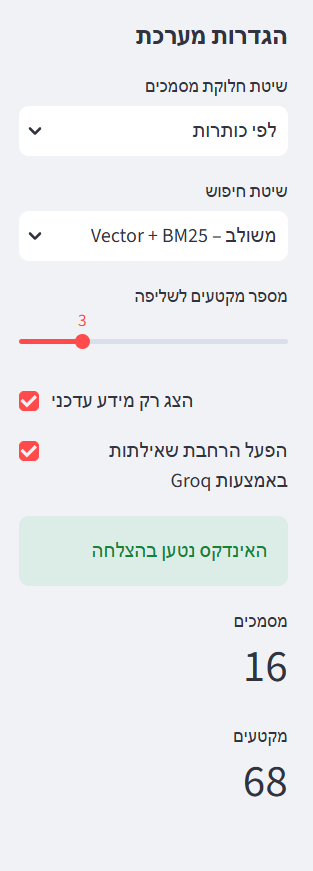
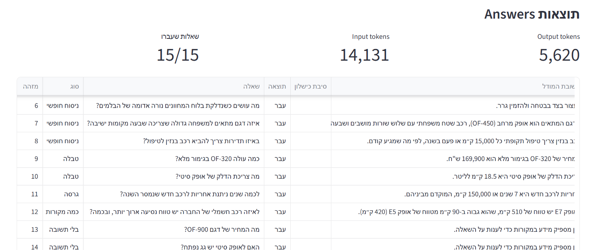
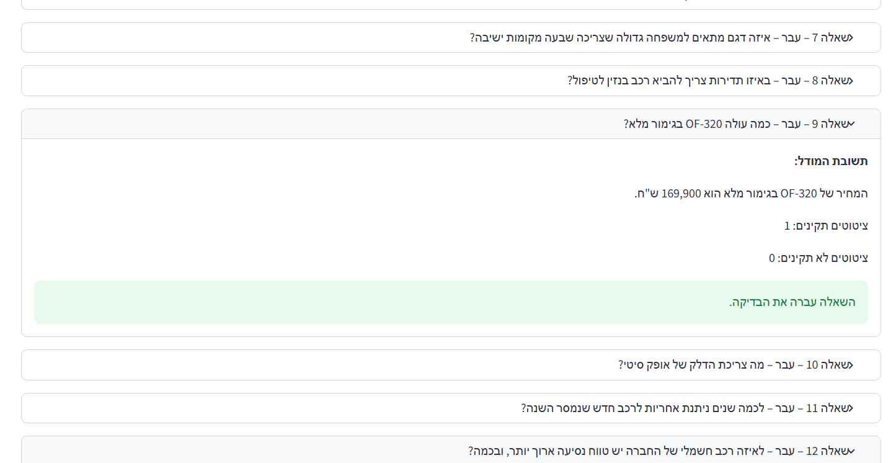
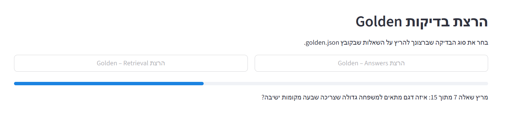

# Car RAG

A Hebrew question-answering and evaluation app for the fictional car company **Ofek Vehicles**. It retrieves passages from the project's Markdown knowledge base, answers from those passages, and checks that the answer's citations match the retrieved text.

> All company, vehicle, pricing, warranty, and service information in this project is fictional and for demonstration and coursework purposes only.

## Features

- Hebrew, right-to-left Streamlit interface for asking questions.
- Markdown knowledge base with 16 fictional company and vehicle documents.
- Configurable fixed-size or heading-based chunking.
- Vector retrieval with `intfloat/multilingual-e5-small`, or hybrid vector + BM25 retrieval combined with reciprocal rank fusion.
- Optional Groq-based query expansion, including splitting comparison questions into focused searches.
- Structured answers with exact-quote citations and citation verification.
- Golden-set evaluation for retrieval and generated answers. The 15 questions are in `golden.json`.
- Optional filtering of superseded documents.

## Requirements and setup

Use Python 3.10 or later. From the project directory, create and activate a virtual environment, then install the listed dependencies:

```powershell
py -m venv .venv
.\.venv\Scripts\Activate.ps1
python -m pip install -r requirements.txt
```

Set a Groq API key in PowerShell before using question answering, query expansion, or answer evaluation:

```powershell
$env:GROQ_API_KEY = "your-groq-api-key"
```

The app enables query expansion by default. You can turn it off in the sidebar, but generating answers and running answer evaluation still require Groq access. The local embedding model may need to download the first time it is used; computed embeddings are cached under `.cache/`.

To use Voyage AI embeddings instead of the local model, install `voyageai` and set both environment variables:

```powershell
python -m pip install voyageai
$env:EMBED_BACKEND = "voyage"
$env:VOYAGE_API_KEY = "your-voyage-api-key"
```

Never put API keys in source files or commit them to Git.

## Run the app

```powershell
streamlit run streamlit_app.py
```

The app lets you choose the chunking strategy, retrieval method, number of retrieved passages, whether to show only current information, and whether to expand queries. You can ask a question or run the Golden Retrieval and Golden Answers evaluations from the interface.

## Run evaluations from the command line

Evaluate retrieval and optionally save its results:

```powershell
python eval_retrieval.py --chunker headings --mode hybrid --current-only --out results/headings-hybrid.json
```

Inspect the passages returned for a particular Golden question:

```powershell
python eval_retrieval.py --chunker headings --mode hybrid --show 7
```

Evaluate generated answers (this calls Groq and incurs API usage):

```powershell
python eval_answers.py --chunker headings --mode hybrid --current-only
```

Run answer evaluation for just one question by adding `--only 13`. Both evaluation scripts also accept `--chunker fixed` or `--mode vector`. Retrieval reports Recall@K and MRR; answer evaluation checks expected content, insufficient-context behavior, and citation validity. Because command-line retrieval uses query expansion, it also needs `GROQ_API_KEY`.

## Project layout

| Path | Purpose |
|---|---|
| `streamlit_app.py` | Hebrew Streamlit interface, interactive question answering, and in-app evaluations |
| `rag/loader.py` | Loads Markdown documents and their front matter |
| `rag/chunking.py` | Fixed-size and heading-based chunking |
| `rag/embed.py` | Local or Voyage embeddings and embedding cache |
| `rag/search.py` | Vector/BM25 retrieval, reciprocal-rank fusion, current-document filtering, and query expansion |
| `rag/answer.py` | Structured answer generation and exact-quote citation verification |
| `data/` | Fictional general company information and vehicle documents |
| `golden.json` | Golden questions, expected answer text, and evaluation expectations |
| `eval_retrieval.py` | Command-line retrieval evaluation |
| `eval_answers.py` | Command-line answer and citation evaluation |
| `REPORT.md` | Evaluation findings and discussion |
| `results/` | Optional directory for saved evaluation output |

## Screenshots to add

The following screenshots were provided and are saved in `screenshots/`:

| Suggested filename | What to capture |
|---|---|
| `screenshots/app-settings.png` | Sidebar settings, successful index load, and corpus counts. |
| `screenshots/golden-answers-results.png` | Golden Answers result table with all 15 questions passing. |
| `screenshots/answer-evaluation-detail.png` | Expanded answer-evaluation result showing the answer and citation checks. |
| `screenshots/golden-evaluation-progress.png` | Golden evaluation while it is running; this is a progress view, not a final results screen. |

### App settings



### Golden Answers results



### Answer and citation check



### Golden evaluation in progress



For a more complete visual overview, add a screenshot of the **Golden Retrieval final results** and, optionally, the main question-and-answer screen with a verified citation. Keep text and metrics legible, and make sure no API keys or other private information are visible.
